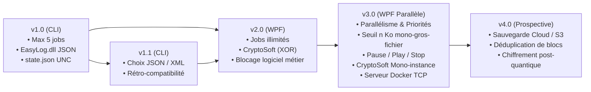

# Synthèse du Projet EasySave (ProSoft) & Matrice de Conformité

> **Projet Fil Rouge - Rattrapage Génie Logiciel (A3 FISA INFO CESI)**  
> **Auteur** : Joan Perrey-Prato  
> **Date d'analyse** : 20 Octobre 2026  
> **Source du cahier des charges** : sujet EasySave ProSoft (Livrables 1 à 3)

---

## 1. Contexte & Modèle ProSoft

* **Éditeur** : ProSoft
* **Produit** : EasySave (solution logicielle de sauvegarde industrielle)
* **Politique tarifaire** :
  * Prix unitaire : **200 € HT**
  * Contrat de maintenance annuel : **12% du prix d'achat** (support 5j/7, 8h-17h, mises à jour incluses, tacite reconduction revalorisée sur l'indice SYNTEC).
* **Contraintes d'ingénierie logicielle** :
  * Environnement : Visual Studio 2022+ / C# / .NET 8.0+.
  * Traçabilité : GitHub avec suivi des versions (branches & tags `v1.0`, `v1.1`, `v2.0`, `v3.0`).
  * Internationalisation : code, commentaires et interfaces exploitables par les filiales anglophones (bilingue FR / EN).
  * Qualité : interdiction de la duplication de code (DRY), fonctions concises, conventions de nommage strictes.
  * Documentations requises : Manuel utilisateur en 1 page, guide support technique, modélisation UML (veille de livrable), étude prospective v4.0.

---

## 2. Spécifications Détaillées par Version

### Livrable 1 - Version 1.0 (CLI)
* **Interface** : Mode console uniquement.
* **Travaux de sauvegarde** :
  * Limité strictement à **5 travaux maximum**.
  * Définition d'un travail : `Nom`, `Répertoire source`, `Répertoire destination`, `Type` (Sauvegarde Complète ou Sauvegarde Différentielle).
  * Supports : disques locaux, disques externes, partages réseau (chemins au format **UNC**).
  * Récursivité : copie intégrale des répertoires et sous-répertoires.
* **Ligne de commande** :
  * `EasySave.exe 1-3` (exécute les travaux 1 à 3).
  * `EasySave.exe 1;3` (exécute les travaux 1 et 3).
* **Logging journalier (`EasyLog.dll`)** :
  * Écriture en temps réel dans un fichier log journalier au format JSON indenté (lisible sous Notepad).
  * Champs minimaux : Horodatage, Nom du travail, Source UNC, Destination UNC, Taille du fichier, Temps de transfert en ms (négatif si erreur).
  * Conçu sous forme d'une bibliothèque dynamique (`EasyLog.dll`) réutilisable pour d'autres projets ProSoft.
  * Emplacement serveur-compatible (proscription stricte de `C:\temp\`, utilisation des dossiers applicatifs système).
* **État en temps réel (`state.json`)** :
  * Fichier unique mis à jour en continu.
  * Informations : Nom, Horodatage, État (Actif / Inactif), Nombre de fichiers éligibles, Taille totale, Progression %, Nombre de fichiers restants, Taille restante, Fichier source en cours, Fichier destination.

---

### Livrable 2 - Versions 1.1 & 2.0

#### Version 1.1 (Maintenance évolutive console)
* Rétro-portage pour les clients conservant le mode console.
* Ajout du choix utilisateur du format des logs journaliers : **JSON ou XML** (avec structure XML standard valide).

#### Version 2.0 (Interface Graphique & Sécurité)
* **Interface graphique** : Abandon de la console, adoption d'une IHM moderne basée sur le pattern **MVVM** (WPF).
* **Capacité** : Nombre de travaux de sauvegarde **illimité**.
* **Chiffrement (`CryptoSoft.exe`)** :
  * Exécutable console dédié indépendant : `cryptosoft.exe <source> <destination>`.
  * Algorithme : **XOR bit à bit** avec clé de chiffrement externe $\ge$ **64 bits** configurable.
  * Code de retour du process :
    * $> 0$ : Temps de chiffrement en millisecondes.
    * $< 0$ : Code d'erreur.
  * Filtrage : chiffrement exclusif des fichiers dont les extensions sont définies par l'utilisateur dans la configuration.
* **Évolution des Logs** :
  * Ajout du temps de chiffrement (`0` = non chiffré, `>0` = ms, `<0` = code d'erreur).
* **Logiciel Métier** :
  * Détection d'un processus métier interdit (ex. calculatrice ou ERP).
  * Si détecté au lancement : **interdiction absolue de lancer** un travail de sauvegarde.
  * Si détecté lors d'un enchaînement séquentiel : finalisation du fichier en cours puis arrêt consigné dans les logs.

---

### Livrable 3 - Version 3.0 (Haute Disponibilité & Parallélisme)

* **Exécution Parallèle** :
  * Abandon du mode séquentiel : exécution concurrente multithreadée de tous les travaux lancés.
* **Gestion des Fichiers Prioritaires** :
  * Liste d'extensions prioritaires paramétrables.
  * Aucun fichier non prioritaire ne doit être sauvegardé tant qu'il reste au moins un fichier prioritaire en attente sur l'un quelconque des travaux.
* **Contrôle de Bande Passante (Gros Fichiers)** :
  * Seuil paramétrable $n$ Ko.
  * Interdiction de transférer simultanément deux fichiers dont la taille dépasse $n$ Ko (sémaphore/verrou d'exclusion mutuelle).
  * Les autres travaux continuent en parallèle le transfert des fichiers $< n$ Ko sous réserve des règles de priorité.
* **Interactivité Temps Réel** :
  * Contrôle unitaire ou global : **Play** (lancement/reprise), **Pause** (effective après le transfert du fichier en cours), **Stop** (interruption propre).
  * Progression en temps réel (pourcentage et jauge pour chaque travail).
* **Logiciel Métier Dynamique** :
  * Si détection en cours de sauvegarde : **mise en pause automatique collective** de l'ensemble des travaux.
  * Reprise automatique dès que le processus métier est fermé.
* **CryptoSoft Mono-Instance** :
  * Restriction système interdisant l'exécution simultanée de plusieurs instances de `CryptoSoft.exe` (Mutex global inter-processus).
* **Centralisation des Logs (Docker)** :
  * Microservice serveur de logs déployable sous conteneur Docker (écoute réseau TCP).
  * 3 modes de journalisation configurables :
    1. Local seul.
    2. Centralisé distant seul.
    3. Hybride (Local + Centralisé distant).
  * Fichier unique journalier sur le serveur avec différenciation automatique des postes/utilisateurs émetteurs.

---

## 3. Matrice de Conformité du Projet EasySave_Joan

| Exigence du Cahier des Charges | Version | Statut | Implémentation |
|---|:---:|:---:|---|
| Console, `EasySave.exe 1-3` et `EasySave.exe 1;3` | v1.0 | OK | `EasySave.CLI/Program.cs`, `ConsoleMenu.ParseJobIndices` (exécutable nommé `EasySave.exe`) |
| 5 travaux maximum, complète / différentielle, sous-dossiers | v1.0 | OK | `BackupService` (MaxJobs = 5), `JobCatalog`, `BackupEngine.GetEligibleFiles` |
| Répertoires locaux, externes, réseau (UNC) | v1.0 | OK | Chemins libres + conversion UNC dans `LogEntry.ToUncPath` |
| DLL `EasyLog.dll` (log journalier temps réel, JSON indenté) | v1.0 | OK | `EasyLog/FileLogger.cs`, `JsonLogger.cs` - ajout en place, champs v1.0 conservés |
| Log : création de répertoire consignée | v1.0 | OK | `BackupEngine.EnsureDirectory` → action `DirectoryCreated` |
| `state.json` unique temps réel (statut lisible) | v1.0 | OK | `StateManager` (statuts en texte : `Active`, `Paused`…) |
| Pas de `C:\temp` | v1.0 | OK | `AppPaths` → `%ProgramData%\EasySave` |
| Choix JSON / XML mémorisé (aussi en ligne de commande) | v1.1 | OK | `XmlLogger`, `AppSettings.LogFormat`, `ConsoleMenu.ShowSettings` |
| Interface WPF MVVM, travaux illimités | v2.0 | OK | `EasySave.WPF/`, `BackupServiceV2/V3` (maxJobs = null) |
| CryptoSoft : XOR, clé ≥ 64 bits en config, code retour ms / négatif | v2.0 | OK | `CryptoSoft/Program.cs`, `cryptosoft.config.json` |
| Chiffrement par extensions + temps de chiffrement dans le log | v2.0 | OK | `BackupEngine.TransferAsync`, `CryptoSoftRunner` |
| Logiciel métier : lancement interdit, fin du fichier en cours en séquentiel, arrêt consigné | v2.0 | OK | `BackupServiceV2` + `BackupRunOptions.InterruptRequested` |
| Sauvegardes en parallèle | v3.0 | OK | `BackupServiceV3.ExecuteJobsParallelAsync` |
| Fichiers prioritaires (attente inter-travaux) | v3.0 | OK | `BackupEngine.Prepare` (tri + enregistrement avant démarrage), `PriorityTransferGuard`, libération en `finally` |
| Un seul fichier > n Ko à la fois | v3.0 | OK | `LargeFileTransferGuard` (`SemaphoreSlim(1,1)`) |
| Play / Pause (après le fichier) / Stop (immédiat) par travail et global, progression | v3.0 | OK | `JobController`, copie annulable dans `BackupEngine.CopyFileAsync`, `MainViewModel` |
| Pause auto si logiciel métier (même déjà lancé), reprise auto, consigné | v3.0 | OK | `BackupServiceV3.PollBusinessSoftware`, `JobController.SetBusinessSoftwarePause` |
| CryptoSoft mono-instance + gestion des problèmes | v3.0 | OK | Mutex (récupération si abandonné), `CryptoSoftRunner` (appels sérialisés, relance si occupé, timeout) |
| Centralisation Docker : fichier journalier unique, utilisateur différencié | v3.0 | OK | `EasySave.LogServer` (réutilise `JsonLogger`), volume `server-logs/`, `machineName` / `userName` |
| Choix Local / Serveur / Local + Serveur | v3.0 | OK | `LogMode`, `LoggerFactory.Create(LogMode…)`, sélecteur dans les paramètres WPF |
| Code et documents en anglais, pas de duplication | Qualité | OK | Moteur unique `BackupEngine` + `BackupServiceBase` ; docs EN |
| Manuel 1 page, guide support, release note | Livrables | OK | `docs/USER_MANUAL.md`, `docs/SUPPORT.md`, `RELEASE_NOTES.md` |
| UML, étude v4.0 | Livrables | OK | `docs/UML_DIAGRAMS.md`, `docs/DIRECTION_V4_STUDY.md` |
| Tests automatisés | Qualité | OK | 70 tests (`EasySave.Tests`, `.WPF`, `.Integration`) |

---

## 4. Architecture & Design Patterns Clés

1. **MVVM** : `MainViewModel` / `JobViewModel`, `RelayCommand`, `INotifyPropertyChanged`, traductions par indexeur.
2. **Héritage + moteur commun** : `BackupServiceBase` (gestion des travaux) et `BackupEngine` (copie, chiffrement, log, état) partagés par v1.x, v2.0 et v3.0 ; chaque version n'ajoute que ses règles via `BackupRunOptions`.
3. **Factory** (`LoggerFactory`) et **Composite** (`CompositeLogger`) : le mode Local + Serveur ne change rien au code appelant.
4. **Template method** : `FileLogger` (ajout en place dans le fichier du jour) spécialisé par `JsonLogger` et `XmlLogger`.
5. **Synchronisation** : mutex système (mono-instance EasySave et CryptoSoft), `SemaphoreSlim` (gros fichiers, CryptoSoft), compteur partagé (priorités), `ManualResetEventSlim` + `CancellationToken` (Pause / Stop).

---

## 5. Synthèse pour la Soutenance & Démonstration

### Scénarios de démonstration recommandés
1. **Démonstration CLI & Compatibilité (v1.0 & v1.1)** :
   * Lancement d'un job via argument ligne de commande (`dotnet run --project EasySave.CLI -- "1;2"`).
   * Inspection des logs JSON et XML générés dans `%ProgramData%\EasySave\Logs\`.
2. **Démonstration WPF & CryptoSoft (v2.0)** :
   * Création d'un job avec chiffrement sur les fichiers `.txt` ou `.docx`.
   * Démonstration de l'exécution de `CryptoSoft.exe` avec affichage du temps de chiffrement dans les logs.
   * Logiciel métier = `CalculatorApp` (calculatrice Windows 11) : une sauvegarde lancée calculatrice ouverte reste en pause puis reprend à sa fermeture.
3. **Démonstration Parallélisme & Haute Disponibilité (v3.0)** :
   * Démarrage simultané de plusieurs sauvegardes volumineuses.
   * Déclenchement de la calculatrice en cours de copie : mise en pause automatique de tous les jobs, puis fermeture de la calculatrice : reprise instantanée.
   * Utilisation des boutons Pause, Play et Stop individuellement.
   * Activation du conteneur Docker du `LogServer` et choix "Local + Serveur" dans les paramètres, puis ouverture de `server-logs/AAAA-MM-JJ.json` (fichier unique, `machineName` / `userName` par entrée).
