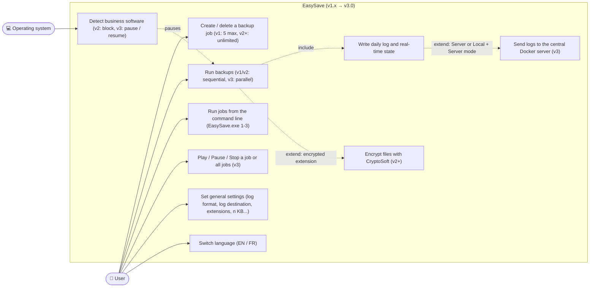
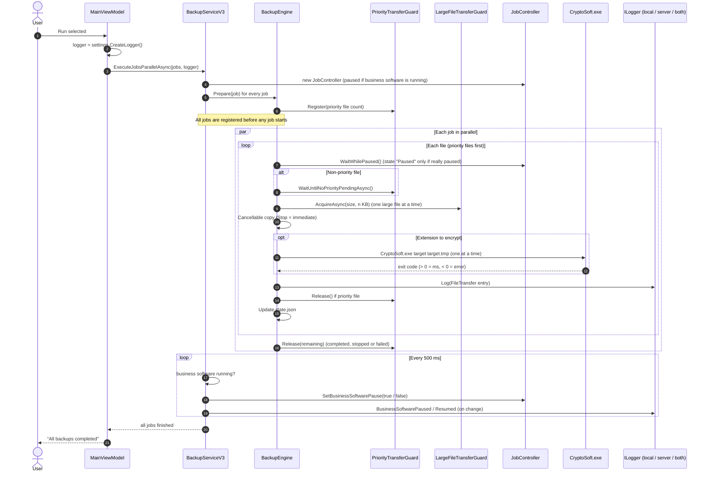
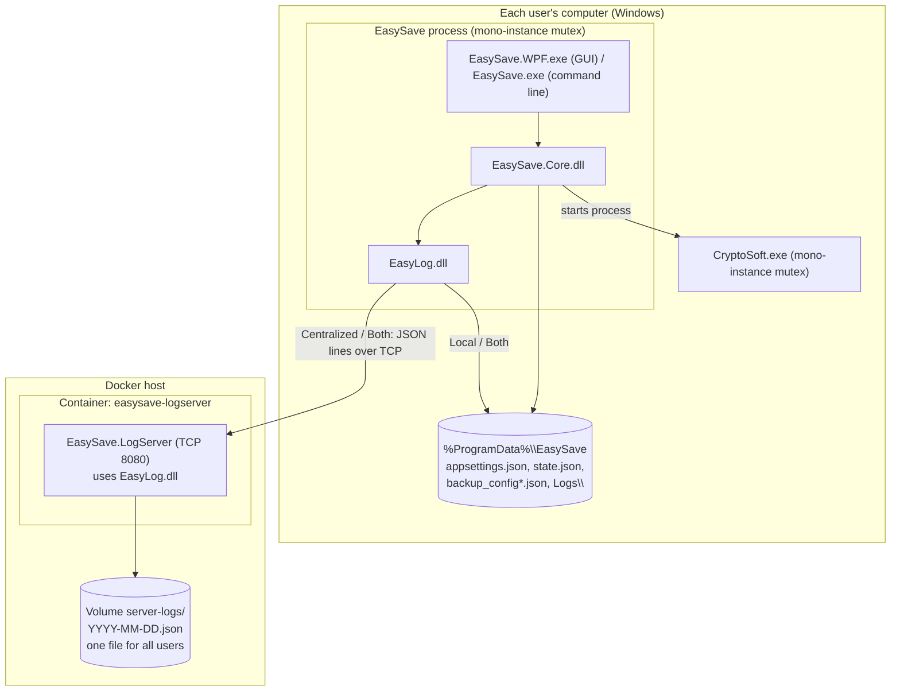

# 📐 UML Models — EasySave

This document gathers the UML diagrams required for each deliverable (v1.0 to v3.0).
Diagrams are written in **Mermaid** (rendered directly by GitHub and VS Code).

---

## 1. Use case diagram

---

## 2. Class diagram

Design patterns:
- **MVVM** for the WPF application
- **Template / inheritance**: `BackupServiceBase` holds the behavior shared by the three versions; each version only adds its own rules
- **Strategy-like options**: one `BackupEngine` for every version, features enabled by `BackupRunOptions`
- **Factory** (`LoggerFactory`) and **Composite** (`CompositeLogger`) for logging
- **Template method** (`FileLogger` → `JsonLogger`, `XmlLogger`)
- **Singleton** (`LanguageProvider`, application-wide `PriorityTransferGuard` and `LargeFileTransferGuard`)

```mermaid
classDiagram
    %% ── Models ──
    class BackupJob {
        +string Name
        +string SourceDirectory
        +string TargetDirectory
        +BackupType Type
    }
    class BackupType {
        <<enumeration>>
        Full
        Differential
    }
    class JobState {
        +string Name
        +DateTime LastActionTime
        +JobStatus Status
        +int TotalFiles
        +long TotalSize
        +int RemainingFiles
        +long RemainingSize
        +double Progress
        +string CurrentSourceFile
        +string CurrentTargetFile
    }
    class JobStatus {
        <<enumeration>>
        Inactive
        Active
        Paused
        Completed
        Error
        Stopped
    }
    BackupJob --> BackupType
    JobState --> JobStatus

    %% ── Services ──
    class IBackupService {
        <<interface>>
        +CreateJob(name, source, target, type) BackupCreationResult
        +DeleteJob(name)
        +GetAllJobs() List~BackupJob~
        +ExecuteJob(name, ILogger)
        +ExecuteJobs(names, ILogger)
    }
    class BackupServiceBase {
        <<abstract>>
        #StateManager StateManager
        #BackupEngine Engine
        +CreateJob(...) BackupCreationResult
        +DeleteJob(name)
        +GetAllJobs() List~BackupJob~
        +GetJob(name) BackupJob
        #RunSequentially(job, logger, options) BackupOutcome
    }
    class BackupService {
        +MaxJobs = 5
        +ExecuteJob(name, ILogger)
        +ExecuteJobs(names, ILogger)
    }
    class BackupServiceV2 {
        +ExecuteJob(name, ILogger)
        +ExecuteJobs(names, ILogger)
    }
    class BackupServiceV3 {
        -Dictionary~string, RunningJob~ _running
        +ExecuteJobsParallelAsync(names, ILogger) Task
        +PauseJob(name) / ResumeJob(name) / StopJob(name)
        +PauseAll() / ResumeAll() / StopAll()
        +HasRunningJobs bool
        -PollBusinessSoftware()
    }
    class JobCatalog {
        +Add(...) BackupCreationResult
        +Remove(name) bool
        +GetAll() List~BackupJob~
        +Find(name) BackupJob
    }
    class BackupEngine {
        +Prepare(job, priorityExtensions) BackupPlan
        +RunAsync(plan, ILogger, BackupRunOptions) Task~BackupOutcome~
        +LogEvent(logger, jobName, action)$
    }
    class BackupRunOptions {
        +EncryptionExtensions
        +PriorityExtensions
        +LargeFileThresholdKb
        +JobController Controller
        +Func~bool~ InterruptRequested
    }
    class BackupPlan {
        +BackupJob Job
        +List~PlannedFile~ Files
        +int PriorityFileCount
    }
    class JobController {
        +Pause() / Resume()
        +SetBusinessSoftwarePause(bool)
        +Stop()
        +WaitWhilePaused()
        +bool IsPaused
        +CancellationToken Token
    }
    class PriorityTransferGuard {
        <<shared>>
        +Register(count)
        +Release(count)
        +WaitUntilNoPriorityPendingAsync(ct)
    }
    class LargeFileTransferGuard {
        <<shared>>
        +AcquireAsync(size, thresholdKb, ct) IDisposable
    }
    class CryptoSoftRunner {
        <<static>>
        +EncryptAsync(file) Task~long~
    }
    class BusinessSoftwareMonitor {
        +string ProcessName
        +IsRunning() bool
    }
    class StateManager {
        +UpdateJobState(JobState)
        +GetAllStates() List~JobState~
    }
    class AppSettings {
        +LogFormat / LogMode
        +LogServerAddress / LogServerPort
        +EncryptionExtensions / PriorityExtensions
        +LargeFileSizeKb
        +BusinessSoftwareName
        +CreateLogger() ILogger
    }

    IBackupService <|.. BackupService
    IBackupService <|.. BackupServiceV2
    BackupServiceBase <|-- BackupService
    BackupServiceBase <|-- BackupServiceV2
    BackupServiceBase <|-- BackupServiceV3
    BackupServiceBase *-- JobCatalog
    BackupServiceBase *-- BackupEngine
    BackupServiceV2 --> BusinessSoftwareMonitor
    BackupServiceV3 --> BusinessSoftwareMonitor
    BackupServiceV3 o-- JobController
    BackupEngine ..> BackupRunOptions
    BackupEngine ..> BackupPlan
    BackupEngine --> PriorityTransferGuard
    BackupEngine --> LargeFileTransferGuard
    BackupEngine ..> CryptoSoftRunner
    BackupEngine --> StateManager
    BackupRunOptions --> JobController

    %% ── EasyLog.dll ──
    class ILogger {
        <<interface>>
        +Log(LogEntry entry)
    }
    class LogEntry {
        +DateTime Timestamp
        +string BackupName
        +string Action
        +string MachineName
        +string UserName
        +string SourceFilePath
        +string TargetFilePath
        +long FileSize
        +long TransferDurationMs
        +long EncryptionDurationMs
    }
    class FileLogger {
        <<abstract>>
        +Log(LogEntry entry)
        #Serialize(LogEntry)* string
    }
    class JsonLogger
    class XmlLogger
    class SocketLogger {
        +Log(LogEntry entry)
    }
    class CompositeLogger {
        +Log(LogEntry entry)
    }
    class LoggerFactory {
        <<static>>
        +Create(LogFormat, dir) ILogger
        +Create(LogMode, LogFormat, dir, host, port) ILogger
    }
    class LogMode {
        <<enumeration>>
        Local
        Centralized
        Both
    }
    ILogger <|.. FileLogger
    FileLogger <|-- JsonLogger
    FileLogger <|-- XmlLogger
    ILogger <|.. SocketLogger
    ILogger <|.. CompositeLogger
    CompositeLogger o-- ILogger
    LoggerFactory ..> ILogger : creates
    LoggerFactory ..> LogMode
    ILogger ..> LogEntry
    AppSettings ..> LoggerFactory

    %% ── MVVM ──
    class MainViewModel {
        +ObservableCollection~JobViewModel~ Jobs
        +ICommand RunSelectedJobsCommand / RunAllJobsCommand
        +ICommand PlayJobCommand / PauseJobCommand / StopJobCommand
        +ICommand PlayAllCommand / PauseAllCommand / StopAllCommand
        +string SelectedLogFormat
        +string SelectedLogMode
        +string this[key]
    }
    class JobViewModel {
        +string Name
        +JobStatus Status
        +double Progress
        +string StatusText
    }
    MainViewModel o-- JobViewModel
    MainViewModel --> BackupServiceV3
    MainViewModel --> AppSettings
```

---

## 3. Sequence diagram — one v3.0 job

---

## 4. Deployment diagram (v3.0)

