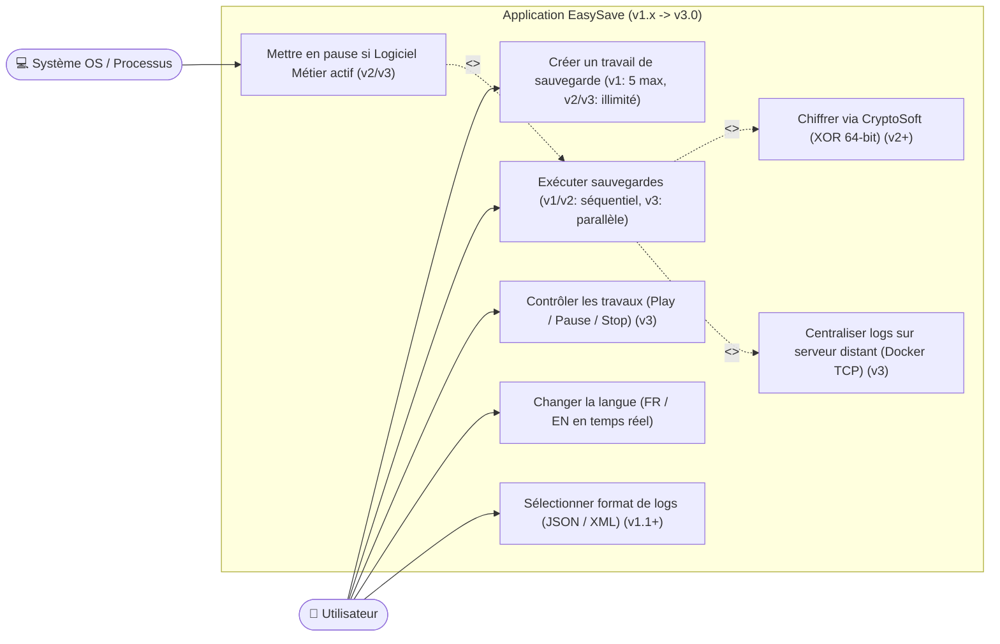
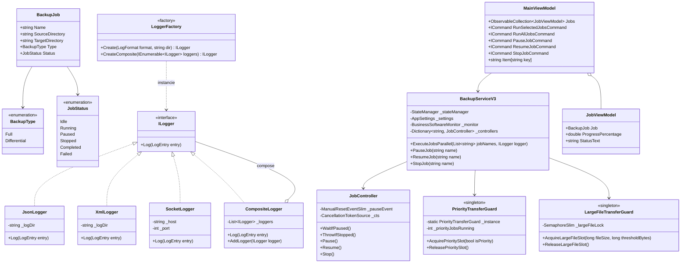
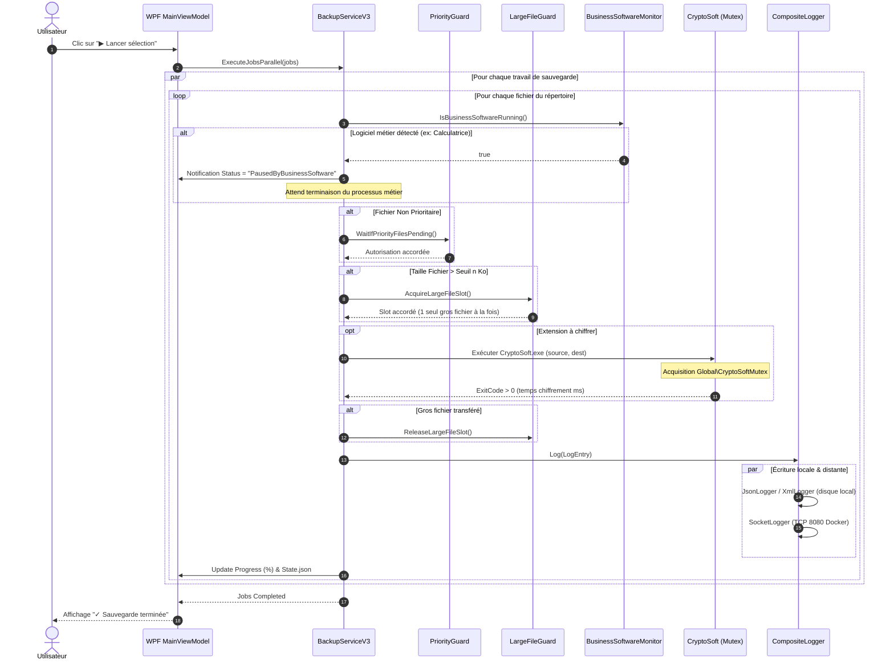
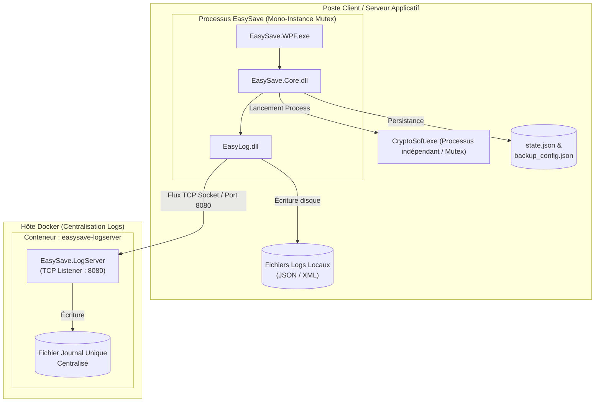

# 📐 Dossier de Modélisation UML — EasySave

Ce document regroupe les diagrammes UML requis par le cahier des charges et le calendrier des livrables (v1.0 à v3.0).  
Tous les diagrammes sont rédigés au format standard **Mermaid** (rendu direct sur GitHub ou VS Code) et **PlantUML** pour exportation PDF/Word.

---

## 1. Diagramme des Cas d'Utilisation (Use Cases)

---

## 2. Diagramme de Classes (Architecture & Design Patterns)

Ce diagramme illustre les principaux Design Patterns mis en œuvre :
- **MVVM** (Model-View-ViewModel pour l'interface graphique WPF)
- **Factory** (`LoggerFactory`)
- **Composite Pattern** (`CompositeLogger` combinant JSON, XML et Socket TCP)
- **Singleton** (`LanguageProvider`, `PriorityTransferGuard`)

---

## 3. Diagramme de Séquence (Sauvegarde Parallèle, Détection Métier & CryptoSoft)

Ce diagramme détaille le cycle d'exécution d'un fichier en v3.0 :

---

## 4. Diagramme de Déploiement (Infrastructure v3.0)

